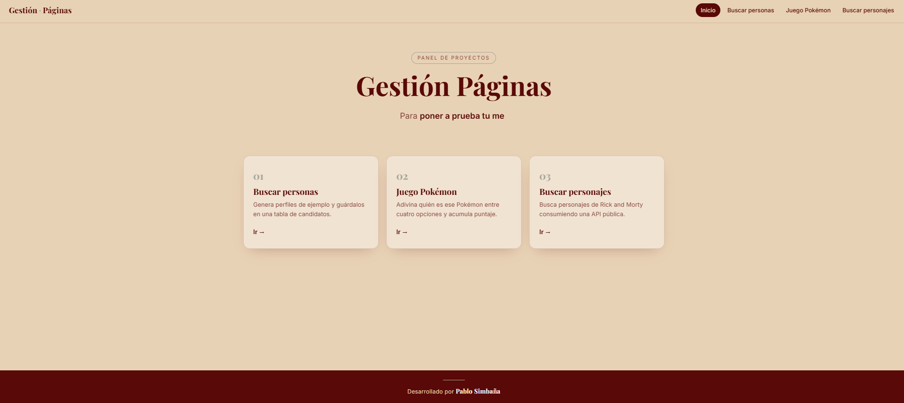
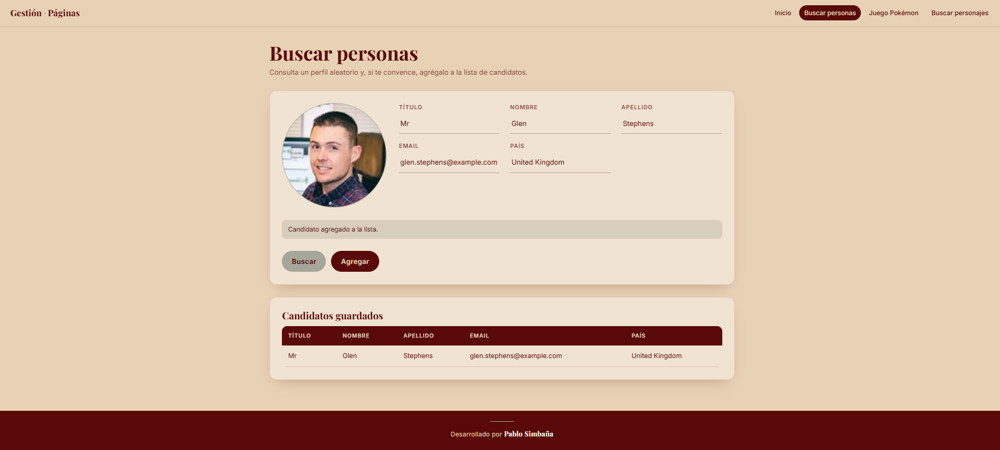
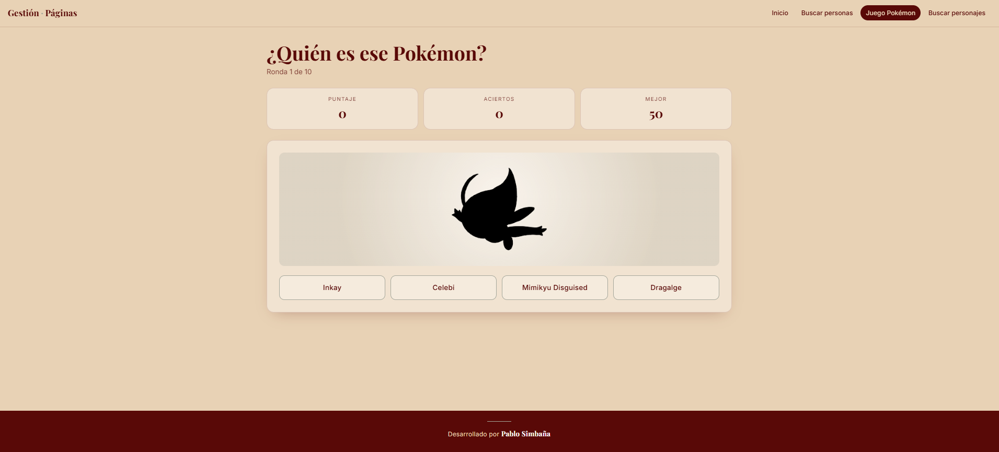
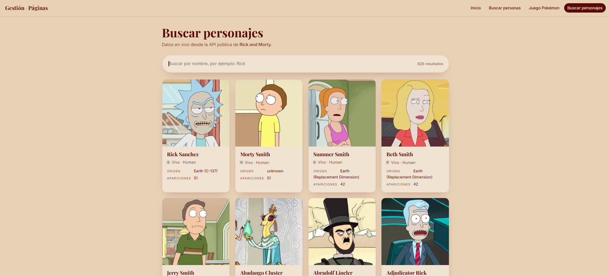
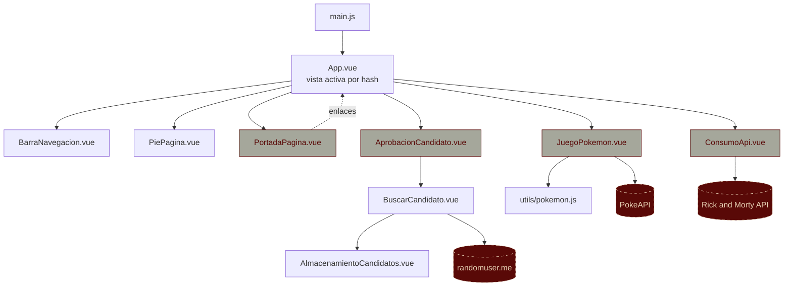

<div align="center" style="padding: 4% 0;">

# Gestión Web
<p>
  
  
  
  
</p>

<p>
  
  
</p>

  ## Capturas
  <div align="center">
    
    
    
    
  </div>

</div>

---

## Descripción

Aplicación de una sola página (SPA) hecha con **Vue 3**. Reúne cuatro vistas con un diseño minimalista:

- **Inicio:** portada con texto animado y acceso rápido a cada sección.
- **Buscar personas:** genera perfiles de ejemplo, los revisa y los agrega a una tabla de candidatos.
- **Juego Pokémon:** adivina el Pokémon entre cuatro opciones y acumula puntaje durante 10 rondas.
- **Explorar API:** busca personajes de *Rick and Morty* consumiendo una API pública, con paginación.

La navegación se hace con el hash de la URL (`#inicio`, `#buscar`, `#pokemon`, `#api`), sin depender de un router externo.

## Características

| Característica | Descripción |
|---|---|
| **Portada animada** | Texto que se escribe y se borra con JavaScript y tarjetas que aparecen al hacer scroll. |
| **Búsqueda de personas** | Consulta un perfil aleatorio desde `randomuser.me` y lo guarda en una tabla de candidatos. |
| **Juego Pokémon** | 10 rondas con silueta del Pokémon, cuatro opciones, puntaje y mejor marca guardada en el navegador. |
| **Explorador de API** | Búsqueda por nombre con retardo (*debounce*), contador de resultados y carga de más personajes. |
| **Animaciones** | Transiciones entre vistas, entrada escalonada de filas y tarjetas, y respeto por `prefers-reduced-motion`. |
| **Diseño propio** | Paleta y tipografía definidas como variables CSS, adaptable a pantallas pequeñas. |
| **Pruebas unitarias** | Lógica del juego probada con Jest y `@vue/test-utils`. |

## Arquitectura

La app tiene un componente raíz que gestiona la vista activa. Cada vista consume su propia fuente de datos externa.



**Nodos centrales:**

| Archivo | Rol |
|---|---|
| `src/App.vue` | Shell de la app: lee el hash, muestra la vista y el pie de página. |
| `src/components/BuscarCandidato.vue` | Formulario de búsqueda y lógica para guardar candidatos. |
| `src/components/AlmacenamientoCandidatos.vue` | Tabla de candidatos guardados. |
| `src/page/JuegoPokemon.vue` | Estado del juego: rondas, puntaje, opciones y persistencia del mejor puntaje. |
| `src/utils/pokemon.js` | Funciones puras del juego (id desde URL, nombres, opciones). Sin llamadas de red. |
| `src/page/ConsumoApi.vue` | Búsqueda, paginación y tarjetas de la API de Rick and Morty. |

## Estructura del proyecto

```text
gestion-web/
├── 📁 public/
│   └── 📄 index.html                 # Plantilla HTML y Google Fonts
├── 📁 src/
│   ├── 📄 main.js                    # Punto de entrada
│   ├── 📄 App.vue                    # Shell: navegación por hash y vistas
│   ├── 📁 assets/
│   │   ├── 📄 estilos.css            # Paleta, tipografía y animaciones globales
│   │   └── 🖼️ logo.png
│   ├── 📁 components/
│   │   ├── 📄 BarraNavegacion.vue    # Menú superior
│   │   ├── 📄 PiePagina.vue          # Pie de página
│   │   ├── 📄 BuscarCandidato.vue    # Búsqueda y formulario de candidatos
│   │   ├── 📄 AlmacenamientoCandidatos.vue
│   │   └── 📄 HelloWorld.vue         # Restante de la plantilla (sin uso)
│   ├── 📁 page/
│   │   ├── 📄 PortadaPagina.vue      # Vista de inicio
│   │   ├── 📄 AprobacionCandidato.vue# Contenedor de la búsqueda
│   │   ├── 📄 JuegoPokemon.vue       # Juego Pokémon
│   │   └── 📄 ConsumoApi.vue         # Explorador de API
│   └── 📁 utils/
│       └── 📄 pokemon.js             # Lógica pura del juego
├── 📁 tests/
│   └── 📁 unit/
│       ├── 📄 pokemon.spec.js        # Pruebas de utils/pokemon.js
│       └── 📄 example.spec.js        # Prueba de la plantilla (HelloWorld)
├── 📄 package.json
├── 📄 vue.config.js
├── 📄 babel.config.js
├── 📄 jest.config.js
└── 📄 jsconfig.json
```

## Stack tecnológico

| Categoría | Tecnología |
|---|---|
| Framework |  Vue 3 (Options API) |
| Herramientas |  Vue CLI 5 (`@vue/cli-service`) |
| Compilación |  Babel, core-js 3 |
| Pruebas |  Jest 27 y `@vue/test-utils` 2 |
| Estilos | CSS con variables, animaciones CSS y transiciones de Vue |
| Animaciones JS | Máquina de escribir, `IntersectionObserver`, `<transition-group>` |
| Tipografía | Playfair Display (títulos) e Inter (texto), vía Google Fonts |
| APIs externas | `randomuser.me`, `pokeapi.co`, `rickandmortyapi.com` (sin clave) |

## Requisitos

- Node.js y npm instalados.
- Conexión a internet (las vistas consumen APIs externas y Google Fonts).

## Comandos

| Comando | Descripción |
|---|---|
| `npm install` | Instala las dependencias. |
| `npm run serve` | Servidor de desarrollo con recarga en caliente. |
| `npm run build` | Genera la versión de producción en `dist/`. |
| `npm run test:unit` | Ejecuta las pruebas unitarias con Jest. |

## Configuración y uso

1. **Instala las dependencias:**

   ```bash
   npm install
   ```

2. **Inicia el servidor de desarrollo** y abre la URL que muestre la consola (normalmente `http://localhost:8080`):

   ```bash
   npm run serve
   ```

3. **Navega entre vistas** con el menú superior o directamente con el hash:

   | URL | Vista |
   |---|---|
   | `/#inicio` | Portada |
   | `/#buscar` | Buscar personas |
   | `/#pokemon` | Juego Pokémon |
   | `/#api` | Explorar API |

## Pruebas

```bash
npm run test:unit
```

La suite cubre las funciones del juego en `src/utils/pokemon.js`: extracción de ids desde URL, nombres legibles, filtrado de formas alternas y generación de opciones sin repetidos.


## Información general

- **Nombre del proyecto:** `webfinal` (carpeta `gestion-web`)
- **Versión:** `0.1.0`
- **Idioma de la interfaz:** Español
- **Estado:** en desarrollo.
- **Notas:**
  - Los datos de candidatos son de ejemplo, obtenidos de `randomuser.me`, y se guardan solo en memoria mientras la página esté abierta.
  - El mejor puntaje del juego se guarda en `localStorage` del navegador.

---

<div align="center">

Desarrollado por **Pablo Simbaña**

</div>
